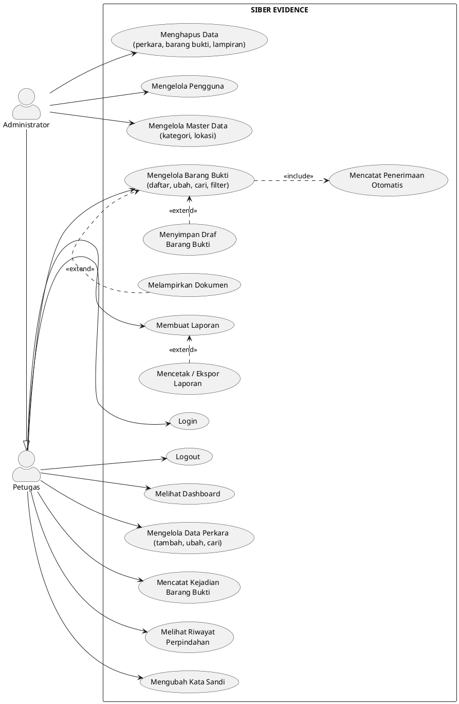

# 1. Analisis Kebutuhan & Use Case

## 1.1 Aktor

| Aktor | Deskripsi |
| --- | --- |
| **Petugas** | Anggota Subbid Siber (penyidik, penyidik pembantu, petugas pengelola barang bukti) yang mencatat perkara, barang bukti, dan setiap perpindahannya. |
| **Administrator** | Pengelola aplikasi. Memiliki seluruh hak Petugas, ditambah menghapus data, mengelola akun pengguna, dan mengelola master data. |

Administrator adalah generalisasi dari Petugas: semua use case Petugas juga dapat dijalankan Administrator.

## 1.2 Kebutuhan Fungsional

| Kode | Kebutuhan | Aktor |
| --- | --- | --- |
| KF-01 | Sistem menyediakan login dengan nama pengguna dan kata sandi; hanya akun berstatus aktif yang dapat masuk. | Semua |
| KF-02 | Sistem menampilkan menu sesuai peran (Petugas / Administrator). | Semua |
| KF-03 | Pengguna dapat melihat dashboard: jumlah barang bukti per status, jumlah perkara per tahap, peminjaman melewati tenggat, aktivitas terbaru, dan draf. | Semua |
| KF-04 | Pengguna dapat menambah, mengubah, mencari, dan memfilter data perkara. Nomor LP tidak boleh ganda. | Semua |
| KF-05 | Administrator dapat menghapus perkara yang tidak memiliki barang bukti. | Administrator |
| KF-06 | Pengguna dapat mendaftarkan barang bukti yang terhubung ke nomor LP. Sistem membuat kode otomatis `BB-tahun-nomor urut`. | Semua |
| KF-07 | Barang bukti dapat disimpan sebagai draf; kejadian Penerimaan baru dicatat saat draf didaftarkan. | Semua |
| KF-08 | Pengguna dapat mengubah, mencari, dan memfilter barang bukti berdasarkan kategori, status, kondisi, dan tahap perkara. | Semua |
| KF-09 | Pengguna dapat melampirkan dokumen pendukung (berita acara, foto) pada barang bukti. | Semua |
| KF-10 | Administrator dapat menghapus barang bukti beserta riwayat dan lampirannya, serta menghapus lampiran. | Administrator |
| KF-11 | Pengguna dapat mencatat kejadian barang bukti: perpindahan, peminjaman, pengembalian, pemeriksaan, pengalihan. Riwayat bersifat tambah-saja. | Semua |
| KF-12 | Mencatat kejadian otomatis memperbarui lokasi dan status barang (peminjaman → Dipinjam, pengembalian → Tersedia, pengalihan ke pemusnahan → Dihancurkan). | Sistem |
| KF-13 | Peminjaman wajib memiliki tanggal harapan kembali; peminjaman yang melewati tanggal tersebut ditandai terlambat. | Semua |
| KF-14 | Riwayat ditampilkan sebagai timeline di detail barang dan sebagai tabel yang dapat difilter. | Semua |
| KF-15 | Pengguna dapat membuat laporan (rekapitulasi, per perkara, status penyimpanan, riwayat, peminjaman) per periode, mencetaknya dalam format A4, dan mengekspor CSV. | Semua |
| KF-16 | Pengguna dapat mengganti kata sandinya sendiri. | Semua |
| KF-17 | Administrator dapat menambah, mengubah, mengaktifkan/menonaktifkan pengguna, dan mengatur ulang kata sandi. Akun tidak dihapus. | Administrator |
| KF-18 | Administrator dapat mengelola master kategori dan lokasi penyimpanan; data yang masih dipakai tidak dapat dihapus. | Administrator |
| KF-19 | Sistem menampilkan notifikasi aktivitas terbaru di header. | Semua |

## 1.3 Kebutuhan Non-Fungsional

| Kode | Kebutuhan |
| --- | --- |
| KNF-01 | **Keamanan:** kata sandi disimpan dalam bentuk hash; hak akses diperiksa di server untuk setiap permintaan. |
| KNF-02 | **Integritas:** pencatatan riwayat dan pembaruan status/lokasi barang dijalankan dalam satu transaksi basis data. |
| KNF-03 | **Ketertelusuran:** setiap riwayat menyimpan waktu, lokasi asal–tujuan, petugas, alasan, dan pengguna yang mencatat. |
| KNF-04 | **Kegunaan:** antarmuka berbahasa Indonesia, tampilan konsisten, dan dapat dipakai di layar desktop maupun ponsel. |
| KNF-05 | **Kerahasiaan:** pengembangan dan pengujian hanya memakai data fiktif. |
| KNF-06 | **Kompatibilitas:** berjalan di peramban modern (Chrome, Edge, Firefox) pada jaringan lokal instansi. |

## 1.4 Diagram Use Case

Kode PlantUML (dapat dirender di [plantuml.com](https://www.plantuml.com/plantuml), draw.io → *Arrange → Insert → Advanced → PlantUML*, atau ekstensi PlantUML di VS Code/IntelliJ).

## 1.5 Daftar Use Case

| ID | Use Case | Aktor | Deskripsi singkat |
| --- | --- | --- | --- |
| UC-01 | Login | Petugas, Administrator | Masuk dengan nama pengguna dan kata sandi. |
| UC-02 | Logout | Petugas, Administrator | Mengakhiri sesi. |
| UC-03 | Melihat Dashboard | Petugas, Administrator | Melihat ringkasan data dan peringatan peminjaman terlambat. |
| UC-04 | Mengelola Data Perkara | Petugas, Administrator | Menambah, mengubah, mencari, dan melihat detail perkara. |
| UC-05 | Mengelola Barang Bukti | Petugas, Administrator | Mendaftarkan, mengubah, mencari, memfilter, dan melihat detail barang bukti. |
| UC-06 | Menyimpan Draf | Petugas, Administrator | Menyimpan isian barang bukti yang belum lengkap. |
| UC-07 | Melampirkan Dokumen | Petugas, Administrator | Menambah berkas pendukung pada barang bukti. |
| UC-08 | Mencatat Kejadian | Petugas, Administrator | Mencatat perpindahan, peminjaman, pengembalian, pemeriksaan, atau pengalihan. |
| UC-09 | Melihat Riwayat | Petugas, Administrator | Melihat dan memfilter riwayat kejadian seluruh barang. |
| UC-10 | Membuat Laporan | Petugas, Administrator | Menyusun laporan berdasarkan jenis dan periode. |
| UC-11 | Mencetak / Ekspor Laporan | Petugas, Administrator | Mencetak A4 atau mengunduh CSV. |
| UC-12 | Mengubah Kata Sandi | Petugas, Administrator | Mengganti kata sandi sendiri. |
| UC-13 | Menghapus Data | Administrator | Menghapus perkara, barang bukti, atau lampiran. |
| UC-14 | Mengelola Pengguna | Administrator | Menambah, mengubah, menonaktifkan akun, dan mengatur ulang kata sandi. |
| UC-15 | Mengelola Master Data | Administrator | Mengelola kategori dan lokasi penyimpanan. |
| UC-16 | Mencatat Penerimaan Otomatis | Sistem | Dijalankan saat barang bukti didaftarkan. |

## 1.6 Skenario Use Case Utama

### UC-01 Login

| | |
| --- | --- |
| **Aktor** | Petugas, Administrator |
| **Prakondisi** | Pengguna memiliki akun. |
| **Pascakondisi** | Pengguna masuk ke dashboard sesuai peran; waktu login terakhir diperbarui. |

| Aksi Aktor | Respons Sistem |
| --- | --- |
| 1. Membuka aplikasi. | 2. Menampilkan halaman login. |
| 3. Mengisi nama pengguna dan kata sandi, lalu menekan **Masuk**. | 4. Memeriksa akun, status aktif, dan kata sandi. |
| | 5. Menyimpan sesi dan membuka dashboard sesuai peran. |

**Alternatif:** 4a. Isian kosong → pesan "Nama pengguna dan kata sandi wajib diisi." · 4b. Akun tidak ditemukan / kata sandi salah → pesan galat. · 4c. Akun nonaktif → pesan "Akun ini berstatus nonaktif."

### UC-05 Mendaftarkan Barang Bukti

| | |
| --- | --- |
| **Aktor** | Petugas, Administrator |
| **Prakondisi** | Perkara (nomor LP) sudah tercatat. |
| **Pascakondisi** | Barang bukti tersimpan dengan kode unik; riwayat Penerimaan tercatat (kecuali draf). |

| Aksi Aktor | Respons Sistem |
| --- | --- |
| 1. Memilih **Tambah Barang Bukti**. | 2. Menampilkan formulir dengan kode otomatis dan petugas penerima terisi. |
| 3. Mengisi informasi umum, perkara, penyimpanan, dan lampiran (opsional). | |
| 4. Menekan **Simpan & Daftarkan**. | 5. Memvalidasi isian (kode unik, tanggal tidak melewati hari ini dan tidak sebelum tanggal laporan). |
| | 6. Menyimpan barang bukti dan mencatat riwayat Penerimaan (`lokasi_asal` = Penyerahan Penyidik). |
| | 7. Membuka halaman detail barang bukti. |

**Alternatif:** 4a. Menekan **Simpan sebagai Draf** → disimpan tanpa riwayat · 5a. Isian tidak valid → kolom ditandai merah.

### UC-08 Mencatat Kejadian (Peminjaman & Pengembalian)

| | |
| --- | --- |
| **Aktor** | Petugas, Administrator |
| **Prakondisi** | Barang bukti terdaftar (bukan draf) dan tidak berstatus Dihancurkan. |
| **Pascakondisi** | Riwayat baru tersimpan; lokasi dan status barang diperbarui. |

| Aksi Aktor | Respons Sistem |
| --- | --- |
| 1. Menekan **Catat Perpindahan**. | 2. Menampilkan formulir; lokasi asal terisi dari lokasi barang saat ini. |
| 3. Memilih jenis **Peminjaman**, lokasi tujuan, petugas, alasan, dan tanggal harapan kembali. | |
| 4. Menekan **Catat Kejadian**. | 5. Memvalidasi isian. |
| | 6. Menyimpan riwayat dengan status kembali "Belum Kembali" dan mengubah status barang menjadi Dipinjam. |
| 7. Saat barang kembali, mencatat kejadian **Pengembalian**. | 8. Menandai peminjaman terbuka sebagai "Sudah Kembali" dan mengubah status barang menjadi Tersedia. |

**Alternatif:** 5a. Barang sudah berstatus Dipinjam → peminjaman ditolak · 5b. Tanggal harapan kembali sebelum tanggal pinjam → ditolak · 5c. Pengembalian untuk barang yang tidak dipinjam → ditolak.

### UC-14 Mengelola Pengguna

| | |
| --- | --- |
| **Aktor** | Administrator |
| **Prakondisi** | Login sebagai Administrator. |
| **Pascakondisi** | Data akun tersimpan / status berubah. |

| Aksi Aktor | Respons Sistem |
| --- | --- |
| 1. Membuka **Manajemen Pengguna**. | 2. Menampilkan statistik dan daftar pengguna. |
| 3. Menekan **Tambah Pengguna**, mengisi username, kata sandi awal, pangkat, nama, NRP, jabatan, peran, status. | 4. Memvalidasi (username unik & format, NRP 8 digit unik, kata sandi ≥ 6 karakter). |
| | 5. Menyimpan akun. |
| 6. Menekan ikon **Nonaktifkan** pada akun. | 7. Meminta konfirmasi, lalu mengubah status menjadi nonaktif. |

**Alternatif:** 6a. Menonaktifkan akun sendiri → ditolak · 6b. Perubahan membuat tidak ada Administrator aktif → ditolak.
