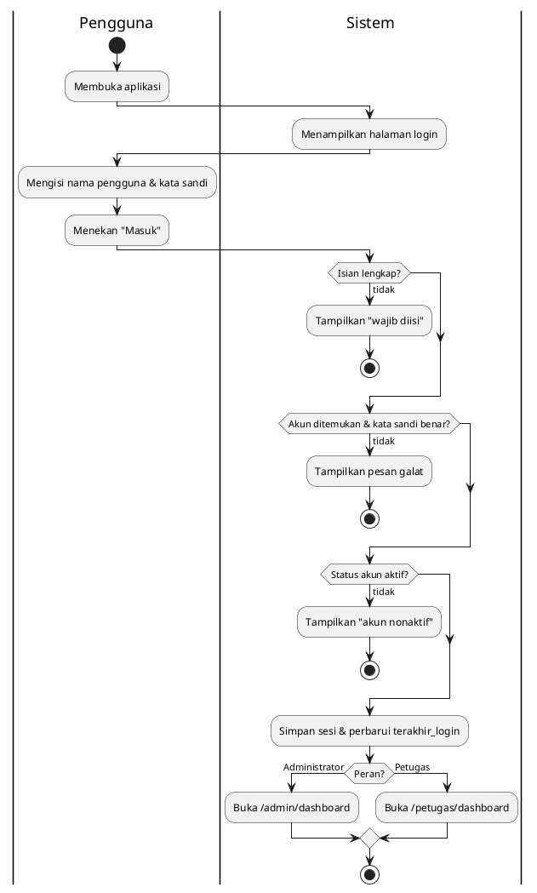
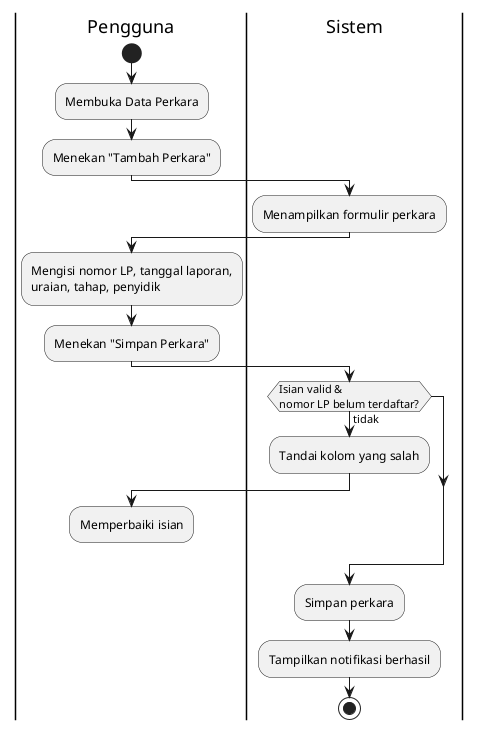
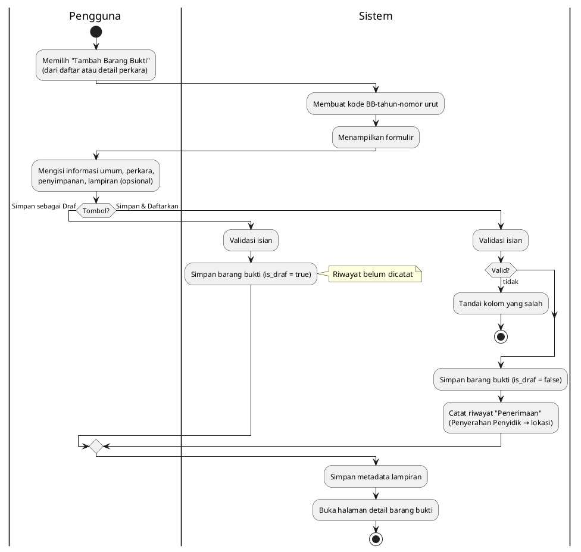
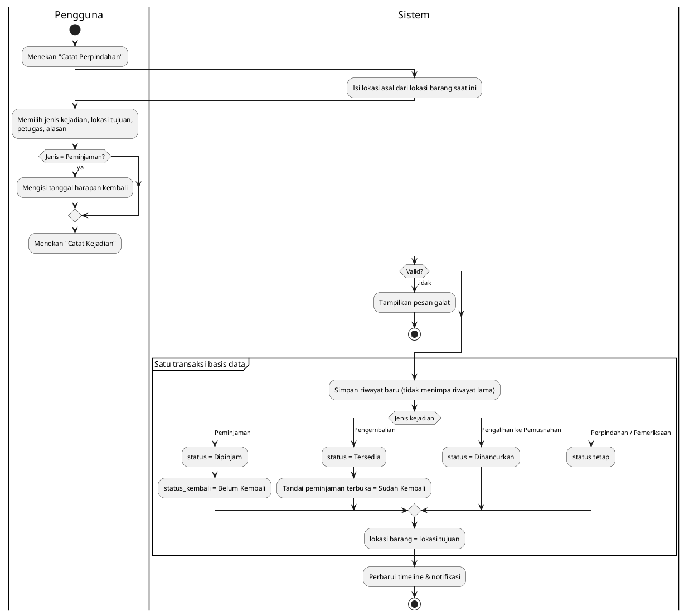
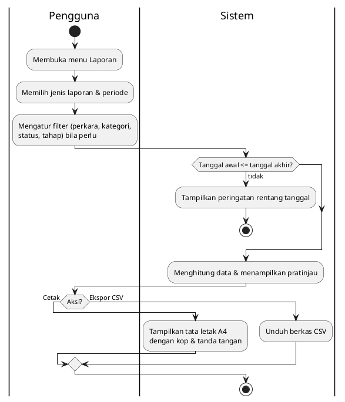
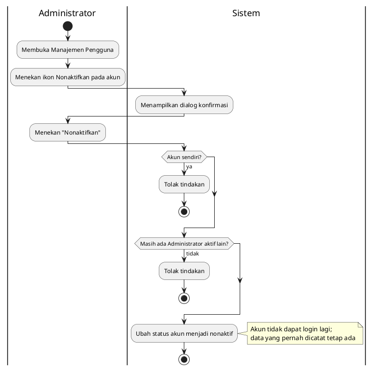

# 2. Activity Diagram

Ditulis dalam PlantUML dengan *swimlane* (aktor | sistem). Cara merender: lihat [01-kebutuhan-dan-use-case.md](01-kebutuhan-dan-use-case.md#14-diagram-use-case).

## 2.1 Login

## 2.2 Menambah Perkara

## 2.3 Mendaftarkan Barang Bukti

## 2.4 Mencatat Kejadian Barang Bukti

## 2.5 Membuat Laporan

## 2.6 Menonaktifkan Pengguna (Administrator)

