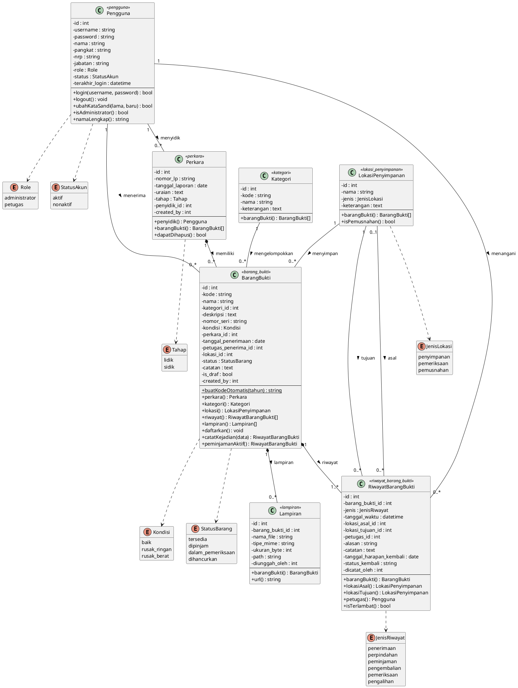

# 3. Class Diagram

Kelas mengikuti model Eloquent yang direncanakan di Laravel (nama tabel pada stereotip). Atribut sama dengan
kolom tabel di [04-erd-dan-kamus-data.md](04-erd-dan-kamus-data.md); metode berisi relasi dan aturan bisnis utama.

**Catatan:**
- Barang bukti terdaftar (bukan draf) selalu memiliki minimal satu riwayat (Penerimaan), karena itu multiplisitas `1..*`.
- `lokasi_asal_id` boleh kosong (`0..1`) untuk kejadian Penerimaan, yang berarti diserahkan oleh penyidik.
- `catatKejadian()` dijalankan dalam satu transaksi: menyimpan riwayat dan memperbarui `lokasi_id` serta `status` barang.
