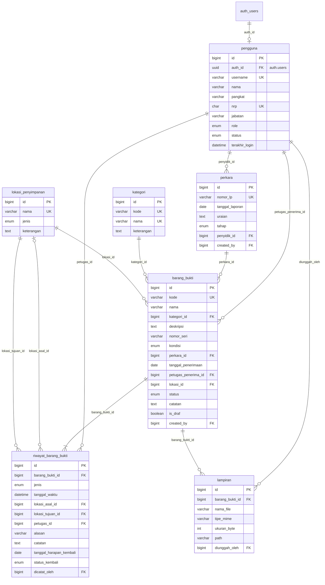

# 4. ERD & Kamus Data

Sumber data contoh: [`fe/src/data/`](../fe/src/data/) — satu file JSON per tabel.

> **Implementasi:** basis data memakai PostgreSQL di Supabase. Skema yang berlaku ada di
> [`supabase/01_schema.sql`](../supabase/01_schema.sql). Padanan tipe: `BIGINT UNSIGNED` → `bigint identity`,
> `ENUM(...)` → tipe enum Postgres, `DATETIME/TIMESTAMP` → `timestamptz`. Perbedaan dari rancangan awal:
> - `pengguna` **tidak menyimpan kata sandi**; kolom `password` diganti `auth_id uuid` → `auth.users(id)` milik Supabase Auth.
> - Kolom `deleted_at` (soft delete) di `perkara` dan `barang_bukti`; nomor LP unik hanya di antara perkara yang belum dihapus.
> - Trigger menolak perubahan/penghapusan riwayat (kecuali `status_kembali` belum → sudah kembali).
> - Hak akses: Row Level Security ([`03_policies.sql`](../supabase/03_policies.sql)); perubahan data lewat fungsi
>   ([`02_functions.sql`](../supabase/02_functions.sql)).

## 4.1 ERD

Semua tabel (kecuali `kategori` dan `lokasi_penyimpanan`) juga memiliki `created_at` dan `updated_at`
(`riwayat_barang_bukti` dan `lampiran` hanya `created_at`, karena tidak pernah diubah).

## 4.2 Kamus Data

Keterangan: **PK** primary key · **FK** foreign key · **UK** unique · **NN** not null.

### pengguna

| Kolom | Tipe | Atribut | Keterangan |
| --- | --- | --- | --- |
| id | BIGINT UNSIGNED | PK, auto increment | |
| username | VARCHAR(30) | UK, NN | Huruf kecil, angka, titik, garis bawah |
| auth_id | UUID | FK → auth.users.id, UK | Akun login Supabase Auth (kata sandi disimpan di sana) |
| nama | VARCHAR(100) | NN | Nama tanpa pangkat |
| pangkat | VARCHAR(20) | | cth. IPDA, BRIPKA; kosong untuk non-anggota |
| nrp | CHAR(8) | UK | Nomor Registrasi Pokok |
| jabatan | VARCHAR(100) | NN | |
| role | ENUM('administrator','petugas') | NN, default 'petugas' | |
| status | ENUM('aktif','nonaktif') | NN, default 'aktif' | Nonaktif tidak dapat login |
| terakhir_login | DATETIME | | |
| created_at, updated_at | TIMESTAMP | | |

### kategori

| Kolom | Tipe | Atribut | Keterangan |
| --- | --- | --- | --- |
| id | BIGINT UNSIGNED | PK | |
| kode | VARCHAR(50) | UK, NN | slug, cth. `media_penyimpanan` |
| nama | VARCHAR(100) | UK, NN | |
| keterangan | TEXT | | |

### lokasi_penyimpanan

| Kolom | Tipe | Atribut | Keterangan |
| --- | --- | --- | --- |
| id | BIGINT UNSIGNED | PK | |
| nama | VARCHAR(100) | UK, NN | |
| jenis | ENUM('penyimpanan','pemeriksaan','pemusnahan') | NN | Pemusnahan memicu status Dihancurkan |
| keterangan | TEXT | | |

### perkara

| Kolom | Tipe | Atribut | Keterangan |
| --- | --- | --- | --- |
| id | BIGINT UNSIGNED | PK | |
| nomor_lp | VARCHAR(60) | UK, NN | cth. `LP/87/IX/2026/Ditreskrimsus` |
| tanggal_laporan | DATE | NN | Tidak boleh melewati hari ini |
| uraian | TEXT | NN | |
| tahap | ENUM('lidik','sidik') | NN | |
| penyidik_id | BIGINT UNSIGNED | FK → pengguna.id, NN | |
| created_by | BIGINT UNSIGNED | FK → pengguna.id | |
| created_at, updated_at | TIMESTAMP | | |

### barang_bukti

| Kolom | Tipe | Atribut | Keterangan |
| --- | --- | --- | --- |
| id | BIGINT UNSIGNED | PK | |
| kode | VARCHAR(20) | UK, NN | `BB-<tahun>-<urut 4 digit>` |
| nama | VARCHAR(150) | NN | |
| kategori_id | BIGINT UNSIGNED | FK → kategori.id, NN | ON DELETE RESTRICT |
| deskripsi | TEXT | | |
| nomor_seri | VARCHAR(100) | | Nomor seri / IMEI |
| kondisi | ENUM('baik','rusak_ringan','rusak_berat') | NN | |
| perkara_id | BIGINT UNSIGNED | FK → perkara.id, NN | ON DELETE RESTRICT |
| tanggal_penerimaan | DATE | NN | ≥ tanggal laporan, ≤ hari ini |
| petugas_penerima_id | BIGINT UNSIGNED | FK → pengguna.id, NN | |
| lokasi_id | BIGINT UNSIGNED | FK → lokasi_penyimpanan.id, NN | Lokasi saat ini |
| status | ENUM('tersedia','dipinjam','dalam_pemeriksaan','dihancurkan') | NN | |
| catatan | TEXT | | |
| is_draf | BOOLEAN | NN, default false | |
| created_by | BIGINT UNSIGNED | FK → pengguna.id | |
| created_at, updated_at | TIMESTAMP | | |

### riwayat_barang_bukti

| Kolom | Tipe | Atribut | Keterangan |
| --- | --- | --- | --- |
| id | BIGINT UNSIGNED | PK | |
| barang_bukti_id | BIGINT UNSIGNED | FK → barang_bukti.id, NN | ON DELETE CASCADE |
| jenis | ENUM('penerimaan','perpindahan','peminjaman','pengembalian','pemeriksaan','pengalihan') | NN | |
| tanggal_waktu | DATETIME | NN | |
| lokasi_asal_id | BIGINT UNSIGNED | FK → lokasi_penyimpanan.id | NULL = Penyerahan Penyidik |
| lokasi_tujuan_id | BIGINT UNSIGNED | FK → lokasi_penyimpanan.id, NN | |
| petugas_id | BIGINT UNSIGNED | FK → pengguna.id, NN | Petugas yang menangani |
| alasan | VARCHAR(255) | NN | |
| catatan | TEXT | | |
| tanggal_harapan_kembali | DATE | | Wajib untuk peminjaman |
| status_kembali | ENUM('belum_kembali','sudah_kembali') | | Hanya untuk peminjaman |
| dicatat_oleh | BIGINT UNSIGNED | FK → pengguna.id | Pengguna yang menginput |
| created_at | TIMESTAMP | | |

### lampiran

| Kolom | Tipe | Atribut | Keterangan |
| --- | --- | --- | --- |
| id | BIGINT UNSIGNED | PK | |
| barang_bukti_id | BIGINT UNSIGNED | FK → barang_bukti.id, NN | ON DELETE CASCADE |
| nama_file | VARCHAR(255) | NN | Nama asli berkas |
| tipe_mime | VARCHAR(100) | NN | |
| ukuran_byte | INT UNSIGNED | NN | Maks. 10 MB |
| path | VARCHAR(255) | NN | Lokasi di storage server |
| diunggah_oleh | BIGINT UNSIGNED | FK → pengguna.id | |
| created_at | TIMESTAMP | | |
