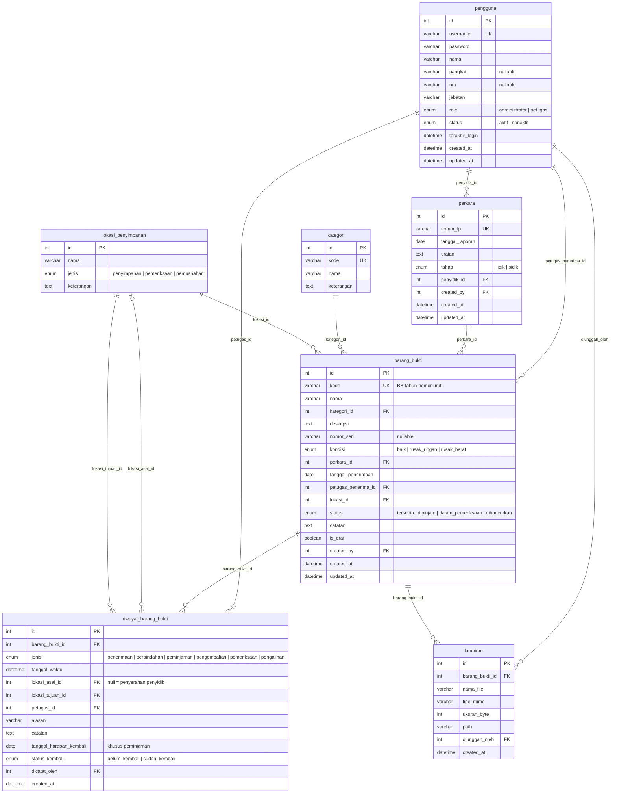

# Data Dummy — Acuan ERD

Folder ini berisi data contoh **fiktif** untuk aplikasi SIBER EVIDENCE. Setiap file JSON mewakili **satu tabel**
MySQL, memakai nama kolom `snake_case` dan `id` integer (seperti auto-increment), sehingga bisa langsung dipakai
sebagai acuan ERD, migration, dan seeder Laravel.

Frontend memuat file-file ini sebagai data awal (seed). Perubahan dari aplikasi disimpan di `localStorage`
peramban. Menu **Pengaturan → Muat Ulang Data Contoh** mengembalikan data ke isi file ini.

| File | Tabel | Isi |
| --- | --- | --- |
| `pengguna.json` | `pengguna` | Akun Administrator dan Petugas |
| `kategori.json` | `kategori` | Master kategori barang bukti |
| `lokasi_penyimpanan.json` | `lokasi_penyimpanan` | Master lokasi penyimpanan |
| `perkara.json` | `perkara` | Data perkara (nomor LP) |
| `barang_bukti.json` | `barang_bukti` | Data barang bukti |
| `riwayat_barang_bukti.json` | `riwayat_barang_bukti` | Riwayat kejadian (chain of custody), tambah-saja |
| `lampiran.json` | `lampiran` | Metadata berkas lampiran barang bukti |

## ERD

## Aturan bisnis yang tercermin di data

- `perkara.nomor_lp` dan `barang_bukti.kode` **unik**. Kode dibuat otomatis: `BB-<tahun>-<nomor urut 4 digit>`.
- Saat barang bukti didaftarkan (bukan draf), sistem otomatis menambah riwayat `penerimaan` dengan
  `lokasi_asal_id = null` (artinya diserahkan oleh penyidik).
- Barang dengan `is_draf = true` belum punya riwayat; riwayat `penerimaan` dibuat ketika draf didaftarkan.
- Riwayat bersifat **tambah-saja** (append-only): data lama tidak ditimpa. Mencatat riwayat ikut memperbarui
  `barang_bukti.lokasi_id` dan `barang_bukti.status`:
  - `peminjaman` → status `dipinjam`, `status_kembali = belum_kembali`, wajib `tanggal_harapan_kembali`.
  - `pengembalian` → status `tersedia`, peminjaman terbuka terakhir menjadi `sudah_kembali`.
  - `pengalihan` ke lokasi berjenis `pemusnahan` → status `dihancurkan`.
  - `perpindahan`, `pengalihan`, `pengembalian` → `lokasi_id` diganti `lokasi_tujuan_id`.
- Peminjaman `belum_kembali` dengan `tanggal_harapan_kembali` sebelum hari ini dianggap **melewati tenggat**.
- Perkara yang masih memiliki barang bukti tidak boleh dihapus. Hapus data hanya untuk Administrator.
- Pengguna `nonaktif` tidak dapat login.
- `password` di sini berupa teks biasa (`demo123`) hanya untuk demo. Di Laravel kolom ini wajib berisi hash bcrypt.

## Akun contoh

| Username | Peran | Status |
| --- | --- | --- |
| `d.kusuma` | Petugas | aktif |
| `b.setiawan` | Petugas | aktif |
| `r.pratama` | Petugas | aktif |
| `m.lumenta` | Petugas | aktif |
| `s.wulandari` | Petugas | nonaktif (tidak bisa login) |
| `admin` | Administrator | aktif |

Semua kata sandi: `demo123`.
